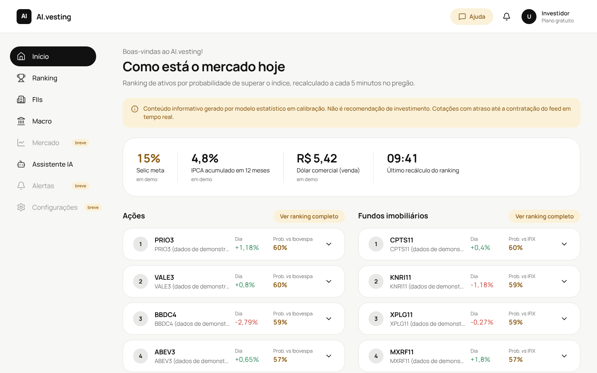

# AI.vesting

App de análise do mercado financeiro com IA nativa. Ranqueia ações e FIIs da B3 pela probabilidade
estimada de superar o índice de referência (Ibovespa, IFIX), recalculando a cada 5 minutos durante o
pregão, e usa IA para explicar cada posição com base em dados micro e macroeconômicos.

> Conteúdo informativo. O app não recomenda compra ou venda. Antes de abrir o ranking ao público é
> preciso um analista CNPI responsável (Resolução CVM 20). Veja a proposta do produto para os detalhes.



## Estrutura

| Pasta | O que é |
|---|---|
| `api/` | Backend em Python (FastAPI): fontes de dados, motor de ranking, agendador de 5 min e explicações com Claude |
| `web/` | Front-end em Next.js + Tailwind. Design system: preto como cor principal, bege de destaque, botões em pílula e cards bem arredondados |
| `supabase/migrations/` | Esquema do banco: histórico de rankings (para medir acertos) e watchlist |

## Como funciona

1. **Dados**: `BrapiProvider` busca cotações e histórico; `BcbClient` busca Selic, IPCA 12 meses e dólar no
   SGS do Banco Central. Ambos ficam atrás de interfaces para trocar por um feed em tempo real (ex.: Cedro)
   sem mexer no resto.
2. **Ranking** (`api/app/ranking`): calcula fatores (momentum, tendência, volatilidade, volume), normaliza
   dentro de cada classe e gera posição, score de 0 a 100 e probabilidade de superar o índice.
   A versão atual (`baseline-v0`) usa pesos fixos e não é calibrada: a probabilidade fica entre 35% e 65%
   até existir histórico para treinar e calibrar o modelo.
3. **Agendador**: recalcula a cada `RANKING_INTERVAL_MINUTES` (5) dentro do horário do pregão e, com
   `SUPABASE_URL` e `SUPABASE_SECRET_KEY`, grava cada ranking no banco para o histórico de acertos.
4. **IA** (`api/app/ai/explain.py`, limitada por IP via `AI_REQUESTS_PER_HOUR`): o Claude recebe só os números calculados e os indicadores macro e
   explica a posição do ativo em português, sem recomendar compra ou venda.
5. **Assistente** (`api/app/ai/assistant.py`, tela `/assistente`): chat em que a Claude usa ferramentas
   (`get_ranking`, `get_asset`, `get_macro`) para consultar os dados do app antes de responder.

## Rodando localmente

Backend:

```bash
cd api
python -m venv .venv && source .venv/bin/activate
pip install -e ".[dev]"
cp .env.example .env           # preencha BRAPI_TOKEN e ANTHROPIC_API_KEY
DEMO_MODE=true uvicorn app.main:app --reload   # DEMO_MODE=true roda com dados sintéticos
pytest
```

Front-end:

```bash
cd web
npm install
cp .env.example .env.local
npm run dev                    # http://localhost:3000
```

## Publicação

Site na Vercel, API no Render (`render.yaml`) e banco no Supabase. Passo a passo em [docs/PUBLICAR.md](docs/PUBLICAR.md).

## Limitações conhecidas

- **Tempo real**: a brapi entrega cotações com atraso. Para o recálculo de 5 minutos ter efeito real é
  preciso contratar um feed licenciado e as tarifas de market data da B3. O app indica na tela quando os
  dados estão atrasados.
- **Histórico**: o modelo precisa de cerca de 6 meses de preços diários por ativo; o plano gratuito da
  brapi pode limitar o período disponível.
- **Login**: a tela `/entrar` é só visual; a autenticação com Supabase Auth ainda não está ligada.
- **Modelo**: ainda sem fundamentos, dados de FIIs (vacância, P/VP) nem macro como fatores; esses entram na
  próxima versão, junto com treino e calibração com histórico.
